<div align="center">
  
</div>

<div align="center">

# 心晴校园 · HeartSync

**面向大学生的身心健康助手 App**

*把「作息 — 运动 — 情绪 — 急救」四条主线，变成一个可感知的健康指数*

[](https://developer.android.com)
[](https://openjdk.org)
[](LICENSE)
[](server/README.md)
[](https://github.com/xibei-wolf/HeartSync/releases/tag/v1.0.0)

</div>

---

## 关于这个项目

大学生的健康问题往往不是「不重视」，而是**没有记录、看不见变化**。睡得少、运动少、情绪低落、不会处理突发状况 —— 每一样都真实存在，却分散在生活里，没有任何一个指标能把它们串起来。

**心晴校园（HeartSync）** 是一款 Android 身心健康助手，围绕这四类真实痛点构建个人健康档案，并接入**大模型 AI** 给出真正个性化、可执行的建议。

它的核心不是「记录」，而是**把分散的日常变成一个可感知的健康指数**（0~100），再用 AI 告诉你「该改什么、怎么改」。

<div align="center">
  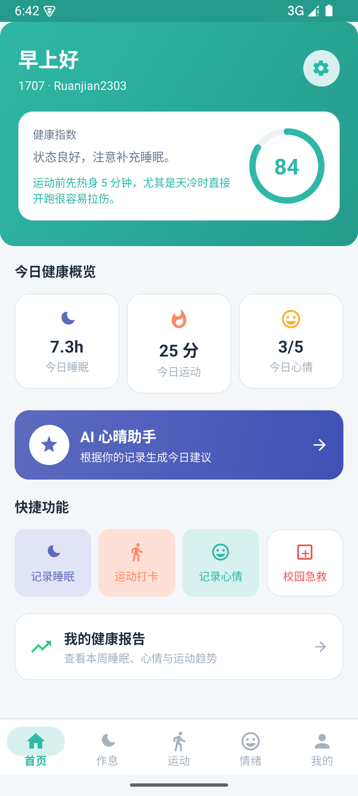
  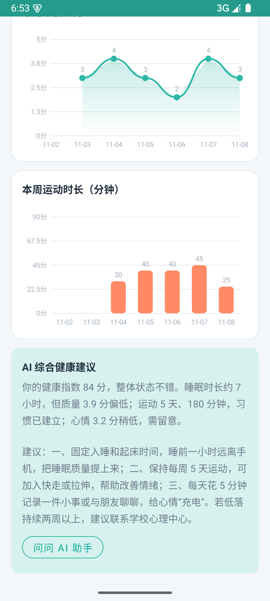
  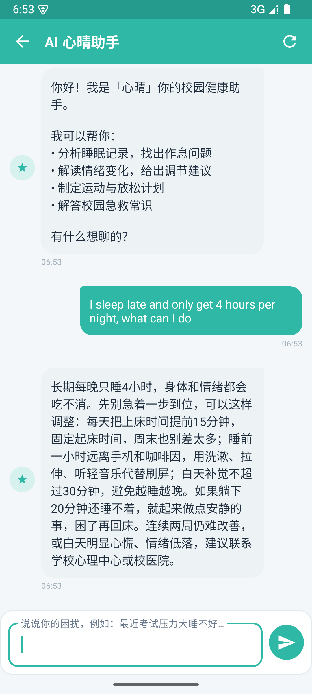
</div>

---

## 下载

<p align="center">
  <a href="https://github.com/xibei-wolf/HeartSync/releases/tag/v1.0.0"></a>
</p>

**Releases 页面**提供三个附件：

| 附件 | 说明 |
|---|---|
| `HeartSync-debug.apk` | Debug 安装包，装到手机/模拟器即可体验全部功能（5.9 MB） |
| `course-report.docx` | 课程设计报告，含 16 张真实截图与完整技术说明（2.0 MB） |
| `demo-video.mp4` | 14 秒核心界面演示录屏（6.4 MB） |

> 首次使用请先在「设置 → 大模型 AI 配置」填入自己的 API Key；未配置时 App 会自动降级到本地知识库兜底，功能不中断。

---

## 功能一览

| 模块 | 能力 | 技术要点 |
|---|---|---|
| 🩺 **作息** | 睡眠记录增删改查、列表、详情、AI 作息分析 | RecyclerView、Intent 传值、DatePickerDialog |
| 🏃 **运动** | 12 种运动打卡、强度分级、热量自动估算 | ChipGroup、RadioGroup、MET 公式 |
| 💭 **情绪** | 5 分制心情 + 多标签 + 情绪日记 + AI 语义分析 | Chip、RatingBar、JSON 解析 |
| 🚑 **急救** | 10 条校园急救知识、分类筛选、搜索、一键呼 120 | JSON 解析、ACTION_DIAL |
| 🤖 **AI 助手** | 大模型多轮对话、逐字输出动画、上下文记忆 | HttpURLConnection、Handler、JSON |
| 📊 **健康报告** | 本周睡眠/心情/运动趋势图 + AI 综合建议 | **自绘 Canvas 图表** |
| 👤 **个人** | 学号注册登录、昵称班级、设置中心 | SQLite、SharedPreferences |

<div align="center">
  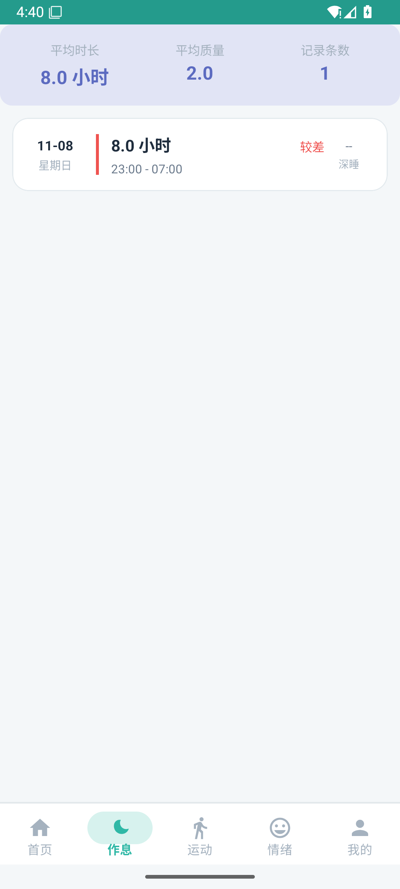
  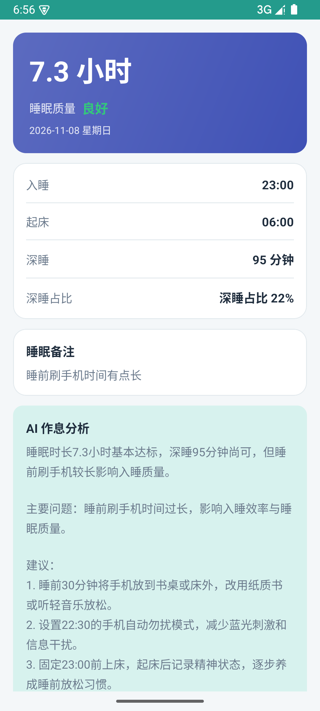
  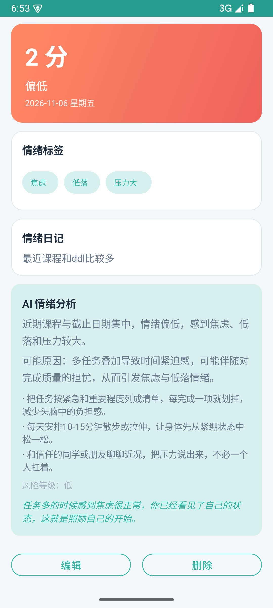
  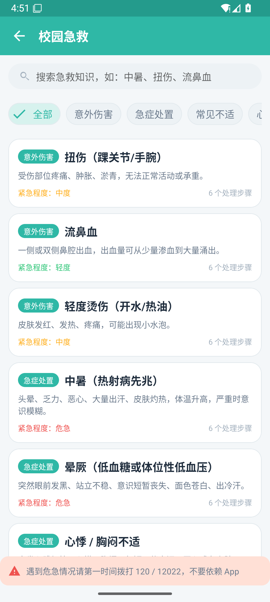
</div>

<div align="center">
  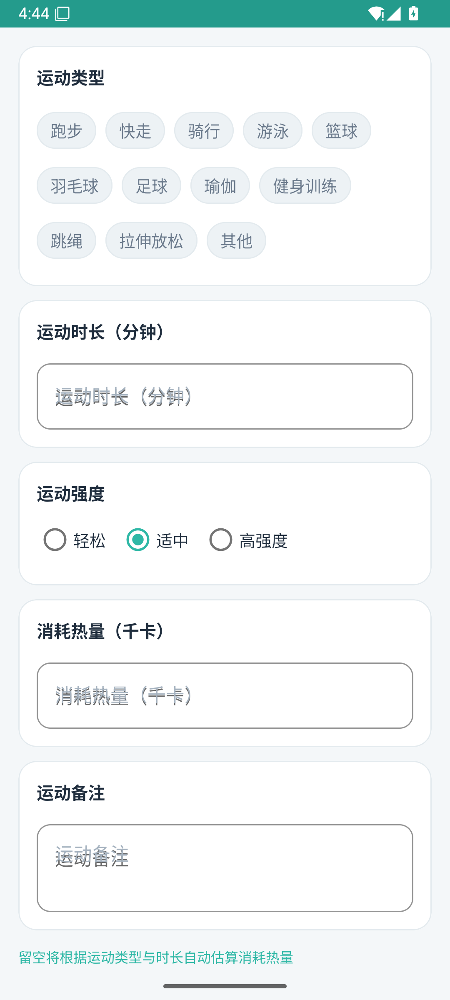
  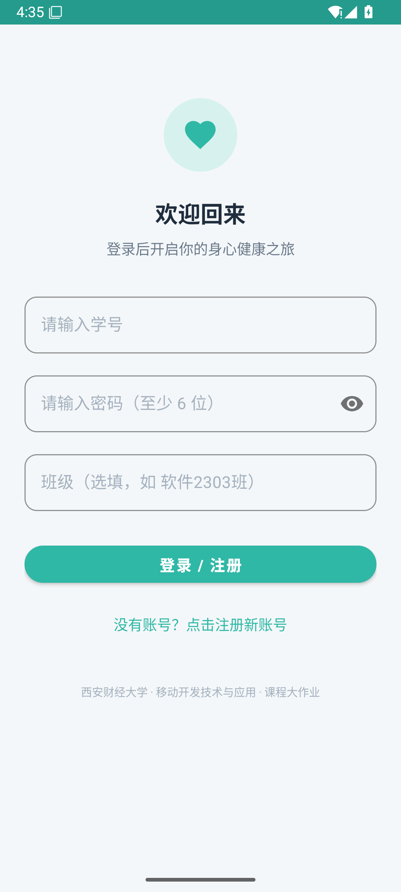
  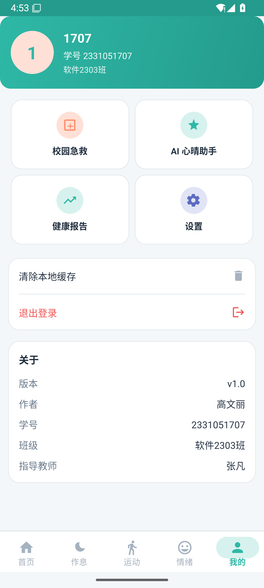
  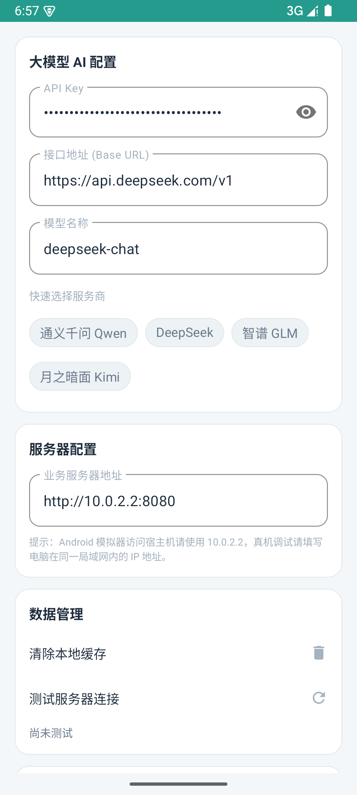
</div>

---

## 四个 AI 微创新

传统健康 App 大多停在「记录完就结束」。这个项目想再往前走一步：

| 创新点 | 传统做法 | 这里的做法 |
|---|---|---|
| **AI 情绪透视** | 存一个「今天 3 分」 | 大模型对情绪日记做**语义级分析**，输出成因、风险等级、3 条可执行建议（结构化 JSON） |
| **AI 作息优化师** | 给一张通用的「早睡早起」表 | AI 读取**真实睡眠记录**（时长/深睡/质量/备注），定位个体化问题再给方案 |
| **AI × 急救双通道** | 一律走网络问 AI | 危急情况优先走**本地急救知识库**（离线可靠、秒开），日常咨询才走大模型 |
| **健康指数引擎** | 数据散在各个列表里 | 睡眠 40 + 运动 30 + 情绪 30 = 0~100 综合指数，让变化**看得见** |

### AI 永不「假装工作」

这是本项目最在意的一点：**界面上不会出现编造的占位文案**。

```
用户提问
   │
   ├─ App 端配了 Key？ ──── 是 ──→ 直连大模型（通义千问 / DeepSeek / 智谱 / Kimi）
   │                                      ↓ 失败
   │                            服务端代理（服务端配了 Key）
   │                                      ↓ 失败
   │                            服务端规则引擎 / 本地急救知识库兜底
   │                                      ↓
   └────────────────────── 真实回答（标注来源）◀──┘
```

三级降级链路保证：**任何时候界面显示的内容都来自真实计算**，没有 Key 也能完整演示，不会崩、不会卡死、不会拿模板糊弄人。

---

## 技术架构

```
┌─────────────────────────────────────────┐
│           Android App（Java）             │
│  13 Activity · 5 Fragment · 5 Adapter    │
├─────────────────────────────────────────┤
│  net/HttpClient   HttpURLConnection      │
│                   + 线程池 + Handler      │
│  db/HeartSyncDb   SQLiteOpenHelper       │
│                   4 张表 · DAO 职责内聚    │
│  widget/          3 个自绘 View          │
│                   Ring / Line / Bar      │
│  ai/AiClient       OpenAI 兼容协议        │
└────────────────┬────────────────────────┘
                 │ HTTP / JSON
┌────────────────▼────────────────────────┐
│      Node.js 服务端（零第三方依赖）         │
│  7 个 REST 接口 · 规则引擎 · AI 代理       │
│  37 条贴士 · 10 条急救 · 12 种运动 MET    │
└─────────────────────────────────────────┘
```

### 值得一看的实现

**① 自绘图表 —— 不用任何第三方图表库**

三张图全部基于 Canvas 手写，因此能完全控制配色、圆角、渐变与文字对齐：

- `RingProgressView` —— 健康指数环形进度，逐帧动画
- `LineChartView` —— 平滑折线 + 渐变填充，**按「连续有效段」分段构建**，缺失日期断开而非补 0
- `BarChartView` —— 圆角柱状图

> 折线图那个「缺失即断点」的细节值得一提：最早的实现把没有记录的日期填成 `0`，结果曲线会从纵轴 0 分陡然拉升，看起来像「心情从 0 突然变好」—— 一眼假。改用 `Float.NaN` 标记缺失、按有效段断开路径后，曲线才如实反映数据。

**② 健康指数算法**

```
睡眠 40 分：7~8 小时得满分 20（区间最优，不是越多越好）+ 质量线性映射 20
运动 30 分：近 7 天累计 150 分钟为满分
情绪 30 分：平均心情分（5 分制）线性映射
```

单项分数经 `Math.max(0, Math.min(上限, ...))` 裁剪，保证任何异常输入都不会破坏整体评分的可解释性。**服务端 `HealthScore` 与 App 端算法完全一致**，两端算出来的分数可以对得上。

**③ 零依赖服务端**

只用 Node.js 内置模块（`http` / `fs` / `path` / `url`），不需要 `npm install`。配套 44 个接口自动化测试用例。

---

## 快速开始

### 环境要求

| 组件 | 版本 |
|---|---|
| JDK | 17+ |
| Android Studio | Ladybug (2024.3)+ |
| Android SDK | Platform 35、Build-Tools 34.0.0+ |
| Gradle | 8.7（项目自带 Wrapper） |
| Node.js | 18+（仅运行服务端时需要） |

### 跑起来

```bash
# 1. 导入
#    Android Studio → Open → 选择仓库根目录（不要进 app/）
#    等待 Gradle Sync 完成

# 2. 运行 App
#    连接模拟器或真机 → ▶️ Run
```

### 启动服务端（可选）

```bash
cd server
node server.js
```

服务端提供每日健康贴士、在线急救库、AI 代理等增强能力。**不启动也能完整使用 App** —— 所有数据都存在本地，急救知识库内置在 assets 里。

### 接入大模型

**方式 A · 填在 App 里**
设置 → 大模型 AI 配置 → 填 Key → 保存。点击服务商 Chip 可自动切换 Base URL 与模型名。

| 服务商 | Base URL | 模型名 |
|---|---|---|
| 通义千问（有免费额度） | `https://dashscope.aliyuncs.com/compatible-mode/v1` | `qwen-plus` |
| DeepSeek | `https://api.deepseek.com/v1` | `deepseek-chat` |
| 智谱 GLM | `https://open.bigmodel.cn/api/paas/v4` | `glm-4-flash` |
| 月之暗面 Kimi | `https://api.moonshot.cn/v1` | `kimi-k1-8k` |

**方式 B · 填在服务端**
复制 `server/.env.example` 为 `server/.env`，填入自己的 Key。App 端留空即可，会自动走服务端代理。

> **Key 安全**：App 端的 Key 只存在手机本地 `SharedPreferences`，不随安装包分发，也不写进源码。服务端的 `.env` 已被 `.gitignore` 排除。

📖 更多细节见 **[开发调试指南](docs/开发调试指南.md)** —— 含模拟器/真机调试、端口转发、常见问题排查。

<details>
<summary><b>以后想继续维护这个项目？</b></summary>

本地工程删掉也不影响 —— GitHub 上的仓库就是唯一真源。

```bash
git clone git@github.com:xibei-wolf/HeartSync.git
cd HeartSync
```

或者直接双击仓库里的 **`重新开始.bat`**，它会自动克隆工程、生成 `local.properties` 与 `server/.env`、校验环境。

完整工作流（拉取 → 改码 → 构建 → 推送）、常见坑与安全约定见 **[二次开发指南](docs/二次开发指南.md)**。

</details>

---

## 项目结构

```
HeartSync/
├── app/                          # Android 应用主体
│   └── src/main/
│       ├── AndroidManifest.xml   # 13 个 Activity 注册
│       ├── assets/first_aid.json # 本地急救知识库（离线兜底）
│       ├── java/com/heartsync/app/
│       │   ├── activity/         # 13 个 Activity
│       │   ├── fragment/         # 5 个底部导航 Fragment
│       │   ├── adapter/          # 5 个 RecyclerView 适配器
│       │   ├── model/            # 5 个实体类（均 Serializable）
│       │   ├── db/               # SQLite 持久化（4 张表）
│       │   ├── net/              # HttpClient、ServerApi
│       │   ├── ai/               # 大模型客户端
│       │   ├── util/             # 日期 / JSON / 评分 / 配置
│       │   └── widget/           # 3 个自绘图表 View
│       └── res/                  # 26 布局 + 42 矢量资源
├── server/                       # 零依赖 Node.js 服务端
│   ├── server.js                 # 7 个 REST 接口
│   ├── test_api.js               # 44 个自动化测试用例
│   └── data/tips.json            # 37 条健康贴士
├── docs/
│   ├── 开发调试指南.md            # 运行 / 调试 / 排错
│   ├── 二次开发指南.md            # 以后想继续维护这个项目看这里
│   └── screenshots/              # 界面截图
├── tools/                        # 开发辅助脚本（不参与编译）
├── 重新开始.bat                  # 一键从 GitHub 恢复工程 + 补齐本地配置
├── LICENSE
└── README.md
```

**规模**：Java 40 个文件 / 7,358 行 · 布局 26 个 · 矢量资源 42 个 · 服务端 51KB

---

## 数据存储

数据库 `heartsync.db`，4 张表：

| 表 | 用途 |
|---|---|
| `t_user` | 账号（学号唯一）、昵称、班级、**SHA-256 哈希密码**（不存明文） |
| `t_sleep_record` | 日期、入睡/起床时间、时长、深睡时长、质量评分、备注 |
| `t_exercise_record` | 日期、类型、时长、强度、**自动估算热量**、备注 |
| `t_mood_record` | 日期、心情分、标签串、情绪日记、**AI 分析缓存** |

运动热量按 MET 公式估算：`热量 = MET × 体重(60kg) × 时长(小时)`

---

## 后续计划

| 现状 | 计划 |
|---|---|
| 数据仅存本地，换机需重新记录 | 接入云同步（Room + 云数据库） |
| API Key 明文存于 SharedPreferences | 改用 Android Keystore 加密存储 |
| 图表为自绘 Canvas，不支持手势缩放 | 增加手势交互或接入 MPAndroidChart |
| 急救知识为静态 JSON | 接入官方数据源定期更新，并补充「何时必须就医」判断标准 |
| 情绪分析是一次性调用 | 增加多轮对话式情绪疏导流程 |

---

## 致谢

- 急救知识参考公开科普资料整理，**不构成医学建议**，紧急情况请拨打 120
- 心理健康援助热线：**12356**（全国统一心理援助热线）
- 图标与配色为自绘矢量资源，未使用第三方素材

---

## 相关说明

本项目最初为西安财经大学《移动开发技术与应用》课程作业（学号 2331051707，指导教师张凡）完成，现以开源形式持续维护。

> ⚠️ 本项目是**学习与演示性质**的作品，不提供医疗诊断或治疗建议。

---

<div align="center">
  <sub>用 ❤️ 和 AI 一起，照顾好每一天的身心状态</sub>
</div>
